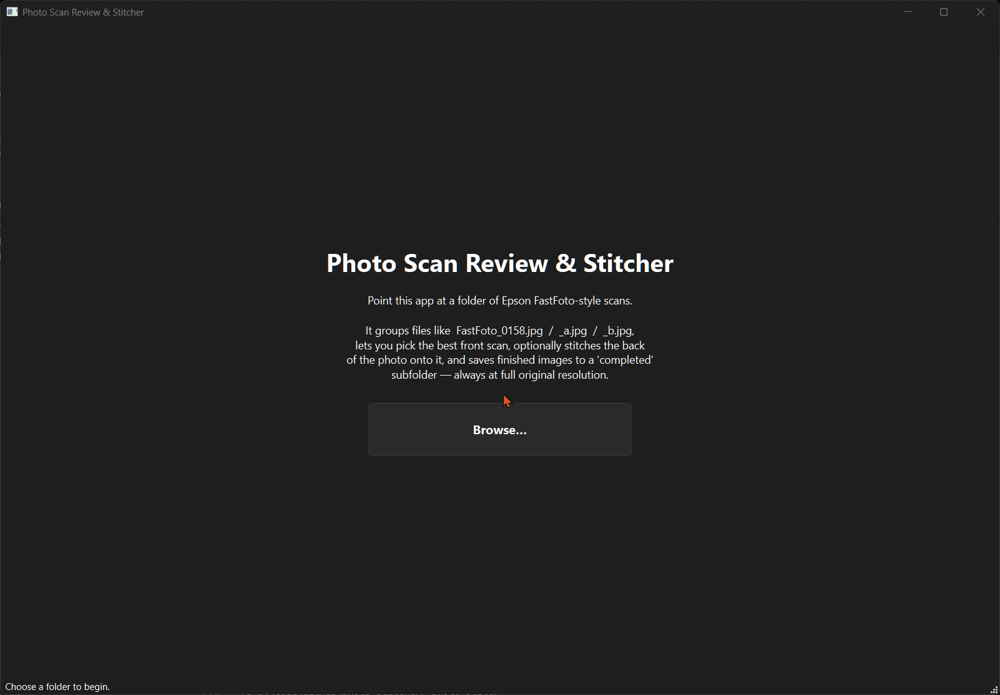
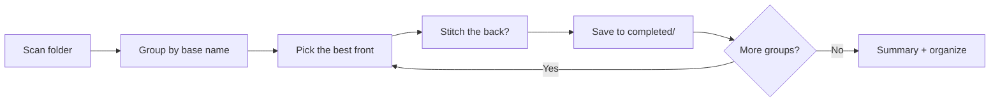

# photo-stitcher

A desktop wizard for reviewing, rotating, and stitching Epson FastFoto-style
photo scans.



## Quick start

Requires Python 3.10+.

```bash
git clone https://github.com/enonymous1/photo-stitcher.git
cd photo-stitcher
pip install -e .   # installs the photo-stitch command
photo-stitch       # pick your scans folder in the dialog
```

Or without installing the command:

```bash
python -m photo_stitcher
```

Optional organizing flags (both commands accept them):

```bash
photo-stitch --move-single-scans --move-reviewed-originals
```

`--move-single-scans` sweeps primary-only groups into `single_scans/`;
`--move-reviewed-originals` moves the originals of finished groups into
`reviewed_originals/`. Without these flags, your originals are never moved
or altered.

## What it does

Point it at a folder of scans and review each photo, one group at a time:

1. **Pick the best front** (side-by-side, when a `_a` scan exists).
2. **Optionally stitch the `_b` back scan** on (top / bottom / left / right),
   with a preview before committing. The back is scaled proportionally to
   match the shared edge; the front is never resampled.
3. **Save** the final full-resolution image to a `completed/` subfolder and
   move on automatically.

Every scan can be rotated 90° in either direction (lossless) from the button
under its preview. The summary screen can filter the queue to all groups,
groups needing a front choice, or groups with a back scan. A progress bar at
the top of each review step shows your position in the queue ("Group 3 of
12"). Image loading shows a brief busy indicator; stitching and saving run
on a worker thread behind a modal progress dialog, so the app stays
responsive even with large scans. When every group is finished, the summary
page stays available so the move-to-`reviewed_originals` / `single_scans`
buttons remain reachable.

Progress is tracked in `.photo_stitch_state.json` inside the source folder,
so you can close the app mid-queue and resume later: finished groups are
skipped, rotations are restored, and each finished group keeps an audit
record of your choices.

## Before and after

```
Before:
  FastFoto_0158.jpg, FastFoto_0158_a.jpg, FastFoto_0158_b.jpg
  FastFoto_0159.jpg

After a review pass (with both organizing flags):
  completed/FastFoto_0158.jpg            best front + back stitched on
  reviewed_originals/FastFoto_0158*.jpg  originals, untouched
  single_scans/FastFoto_0159.jpg         primary-only group, swept aside
```

## Naming convention

```
FastFoto_0158.jpg      primary front scan
FastFoto_0158_a.jpg    optional second front scan
FastFoto_0158_b.jpg    optional back-of-photo scan
```

Files are grouped by base name. Groups with only a primary scan are ignored
by the review queue (they can be swept into `single_scans/` instead).

## Origin

This started with an Epson FastFoto scanner and a pile of old family photos.
The scanner does a great job digitizing — front scans, plus back scans for
the handwritten notes on the reverse — but it leaves you with a folder of
files and no good way to pick the best front, pair each photo with its back,
or straighten the ones that came out sideways. This is the tool I wished
existed: a simple review pass over each photo, stitch the back on when you
want it, and end with a clean `completed/` folder.

It isn't affiliated with or endorsed by Epson; it just works with the
`[Base].jpg` / `[Base]_a.jpg` / `[Base]_b.jpg` naming the scanner produces,
and with any other scans renamed to match.

## Non-goals

- Not a scanner driver — it works on files the scanner already produced.
- Not a photo editor — no color correction, cropping, or red-eye removal.
- Not automatic — every group with a decision in it gets a human review
  pass, deliberately. The point is curation, not bulk processing.
  Organizing is the exception: single-scan groups have nothing to review,
  so they can be sorted into `single_scans/` automatically on demand (the
  `--move-single-scans` flag, or the summary screen's "Move single scans…"
  button), and finished originals the same way into `reviewed_originals/`.
- Not a panorama stitcher — it composites a photo's front with its back,
  nothing wider.

## How it works



<details>
<summary>Layout</summary>

```
src/photo_stitcher/
    constants.py   shared constants (folder names, patterns, quality)
    grouping.py    scan grouping + organizing (Qt-free)
    imaging.py     full-res loading + stitching via Pillow (Qt-free)
    state.py       progress tracking in JSON (Qt-free)
    cli.py         argparse + `photo-stitch` entry point
    gui/
        widgets.py Qt widgets (scalable image label, pixmap helpers)
        wizard.py   the review wizard (MainWindow)
        workers.py  QThreadPool workers: pure-Pillow stitch/save jobs
tests/
    test_logic.py       grouping / imaging / state / organizing tests
    test_guiflow_mock.py  full wizard flow with stubbed PyQt6 (headless)
```

The `grouping`, `imaging`, and `state` modules have no Qt dependency and can
be reused headlessly (e.g. batch-organizing scans from a script).

</details>

<details>
<summary>Tests</summary>

```bash
python tests/test_logic.py
python tests/test_guiflow_mock.py
# or, with pytest installed:
python -m pytest tests/ -q
```

The GUI flow tests stub out PyQt6, so they run anywhere with Pillow
installed — no display or Qt system libraries needed.

</details>
